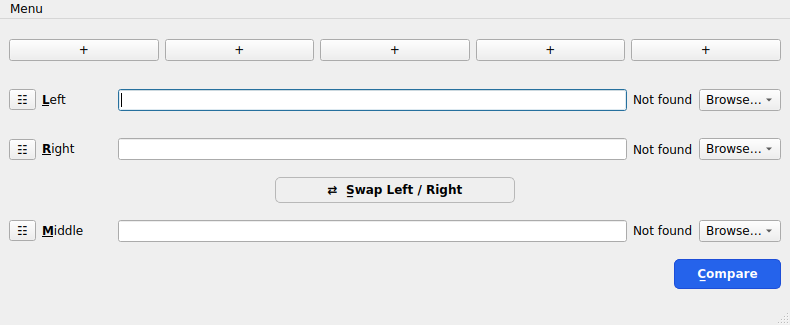
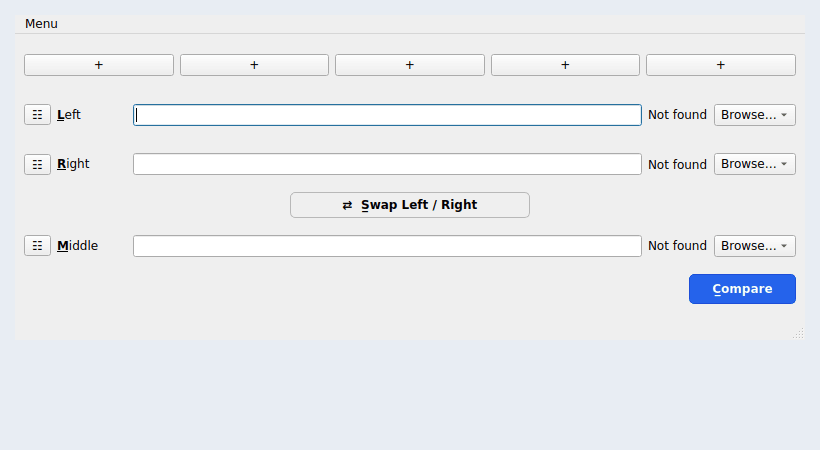
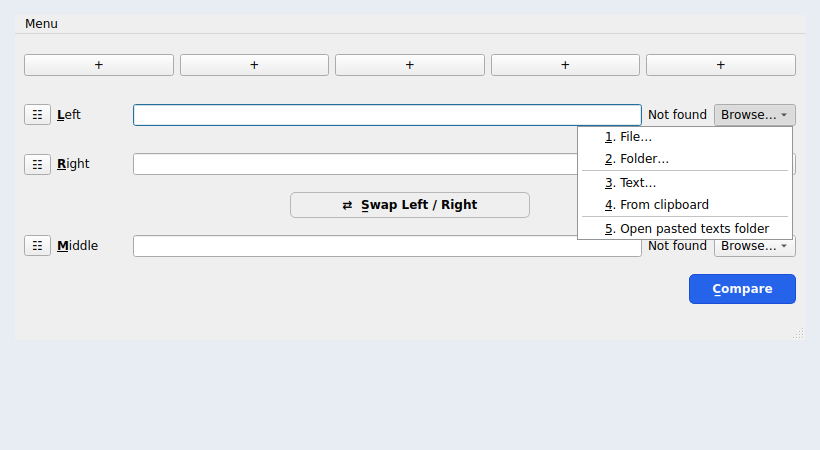
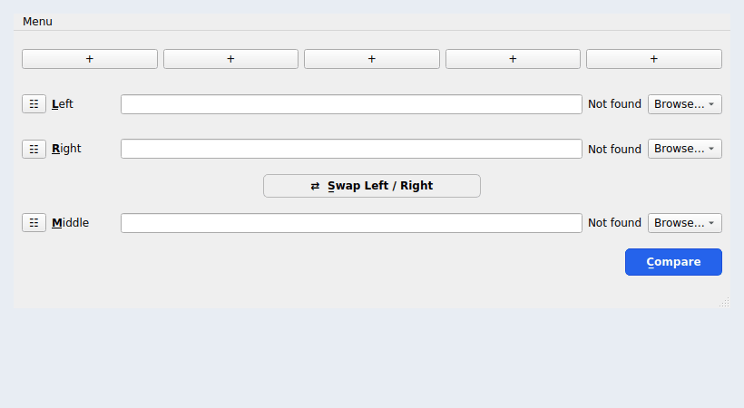
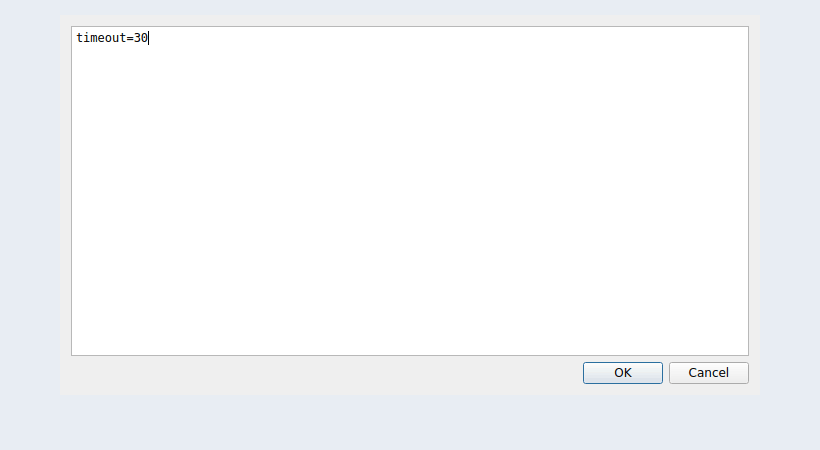
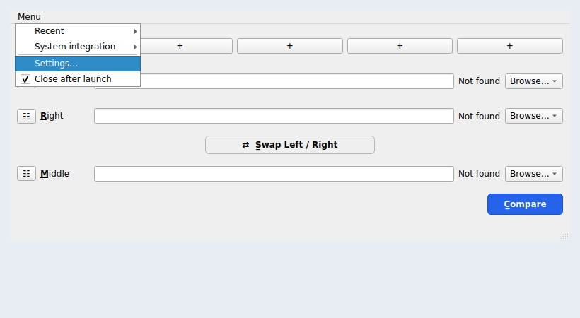
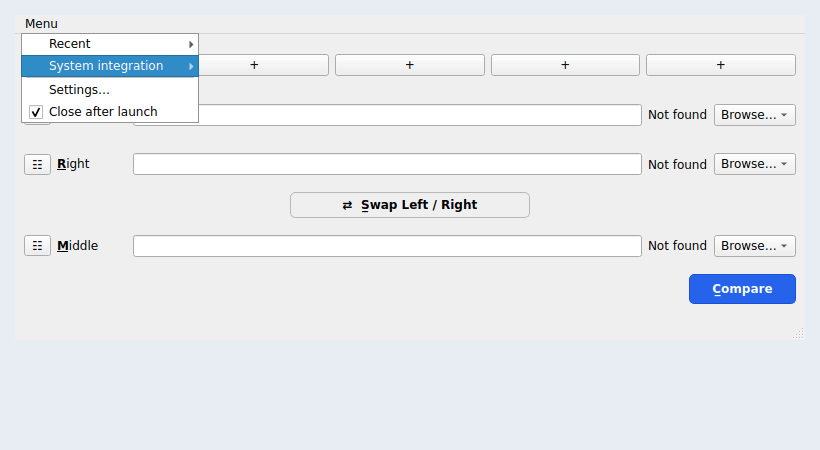

# Diffpick user guide

Diffpick opens file, folder, and text comparisons in Meld. Install Meld
separately, then open Diffpick. For installation instructions, see the
[project README](../README.md).



The screenshots and animations below show Diffpick running on Linux with sample
files. Native file pickers may look different on your system.

- [Compare two files](#compare-two-files)
- [Input fields and Browse menu](#input-fields-and-browse-menu)
- [Browse locations](#browse-locations)
- [Comparison examples](#comparison-examples)
- [Menu and settings](#menu-and-settings)
- [File manager integration](#file-manager-integration)
- [Keyboard shortcuts](#keyboard-shortcuts)
- [Command-line examples](#command-line-examples)

## Compare two files

1. Press **Alt+L**, then **1**, and choose `before.txt`.
2. Press **Alt+R**, then **1**, and choose `after.txt`.
3. Press **Alt+C** to open the comparison in Meld.



The **Compare** button does the same as **Alt+C**. **Left** and **Right**
are required. Add **Middle** for a three-way comparison.
If you select the same file or folder more than once, choose **Compare anyway**
to open it in Meld, or **Cancel** to return to the inputs.

## Input fields and Browse menu

Type an absolute path, paste it into the field, or drag an item from your
file manager. Click the field's clear button to empty it. The status beside
the field shows whether the input is a file, a folder, or pasted text, or
whether Diffpick is still checking it. If you see **Not found** beside a
nonempty field, check the path or select the item again.

Click **Left**, **Right**, **Middle**, or **Browse…** to open that input's menu.
Press a number while the menu is open to run the corresponding action.



| Key | Action | Example |
| --- | --- | --- |
| **1** | **File…** | Choose `before.txt` for the current input. |
| **2** | **Folder…** | Choose a `backup` directory to compare against a working directory. |
| **3** | **Text…** | Paste a configuration snippet into the editor, then press **Ctrl+Enter**. Reopen **Text…** to edit that snippet. |
| **4** | **From clipboard** | Copy two selected files in your file manager, then choose this action to fill **Left** and **Right**. |
| **5** | **Open pasted texts folder** | Locate a temporary `Text (left).txt` file or the diagnostic log. |

**From clipboard** first checks for copied files, then for up to three
lines that each name an existing absolute path. Other clipboard text is
saved as a snippet for the current input. When you paste multiline text into a
path field with **Ctrl+V**, Diffpick uses the same clipboard handling.

A single dropped item goes into the field you drop it on. Two items fill
**Left** and **Right**. Three fill **Left**, **Middle**, and **Right** in order.
Drop plain text on a field to use it as a snippet. To exchange inputs, drag the
handle next to one field onto another. **Swap Left / Right** exchanges those
two fields and leaves **Middle** in place.

## Browse locations

The row above **Left** can save up to five folders.

- Click **+** in an empty position and choose a folder.
- Click its name to activate it. Click the active folder again to deactivate it,
  or click another saved folder to switch.
- Hover over a location to see its full path. Click **×** next to it to remove it
  from the row. The folder and its files stay on disk.



For example, save a `reports` folder and activate it. On an empty **Right**
field, **Browse… → File…** opens in `reports`. If a field already points to a
file or folder, Browse starts there. For a file, that means its containing
directory. Otherwise the starting order is the active saved folder, the last
folder used for browsing, then your home directory. Unavailable folders are
skipped. Changes to the saved locations are kept between sessions.

## Comparison examples

| Inputs | What happens |
| --- | --- |
| **Left** = `before.txt`, **Right** = `after.txt` | Meld opens a two-way file comparison. |
| **Left** = `backup/`, **Right** = `working/` | Meld opens a directory comparison. |
| **Left** = `local.ini`, **Middle** = `base.ini`, **Right** = `incoming.ini` | Meld opens all three side by side, with the base in the middle. |
| **Left** = `report.txt`, **Right** = `archive/` | Diffpick asks which files from `archive/` to compare. If you select several, it requests one Meld comparison per selected file. |
| **Left** = a pasted snippet, **Right** = `settings.ini` | Meld compares the saved snippet and the file. |

To compare two snippets, open **Alt+L → 3** and enter `timeout=30`. Use
**Ctrl+Enter** to save it. Repeat with **Alt+R → 3** and `timeout=45`, then
press **Alt+C**. Pasted snippets are stored as local temporary files so Meld
can open them. Use **Delete now** in Settings to remove the saved snippets
when you are done with them.



## Menu and settings

| Item | What it does |
| --- | --- |
| **Recent** | Restores the inputs from one of the last 15 successful comparisons. For example, select yesterday's `before.txt ↔ after.txt`, then press **Compare** to launch it again. Click **×** at the left of an entry to remove it from the history. |
| **Close after launch** | Closes Diffpick after Meld starts. Turn it off if you want to keep selecting comparisons in the same window. |
| **System integration** | Installs, repairs, or removes file manager actions for your user account. See [File manager integration](#file-manager-integration). |
| **Settings…** | Opens the preferences below. **OK** saves the Meld command and logging preference. |



| Settings item | What it does |
| --- | --- |
| **Meld command** and **Choose…** | Set a custom command, or select the Meld executable with the picker. On Linux, `flatpak run org.gnome.meld` is an example of a custom command. |
| **Auto-detect** and **Detected command** | Clear the override and check what Diffpick finds. **Detected command** shows the command it would use. |
| **Pasted texts → Open folder** | Opens the directory that holds saved snippets and any diagnostic log. |
| **Pasted texts → Delete now** | Asks for confirmation, then deletes saved snippet files. Recent entries referring to deleted snippets may no longer reopen. |
| **Settings file → Open folder** | Shows the full path to `diffpick.ini` and opens its containing directory. This file includes saved browse locations and preferences. |
| **Enable diagnostic logging** | Records startup, command, and error details in `diffpick.log` in the pasted-text folder. Enable it while reproducing an issue and review file paths in the log before sharing it. |

## File manager integration

Choose **Menu → System integration → Install** to add the supported file
manager actions. The confirmation lists the registry keys or paths where
Diffpick installed them. Use **Repair** after moving the extracted Windows
folder or the Linux AppImage. Use **Remove** before deleting the application.



| File manager action | Example |
| --- | --- |
| **Open in diffpick** | Right-click `before.txt` and choose this action to fill the window. Add a second item and press **Compare** when ready. |
| **Mark for compare** | Mark `before.txt` to remember it across folders and restarts. |
| **Compare with marked** | Right-click `after.txt` and choose this action to compare it with the saved item. The mark remains available for another comparison. |
| **Windows: Send to → diffpick** | Select up to three items in Explorer. The shortcut sorts them by name and opens Diffpick with the fields filled. Click **Compare** when ready. |
| **Linux: Compare selected** | Select two or three items to sort them by name and start a comparison directly. |

On Windows 11, look under **Show more options** in Explorer for the classic
context-menu entries. On Linux, look under **Scripts → Diffpick** in
Nautilus, Nemo, or Caja, or look for **Diffpick** in Dolphin's context menu.

## Keyboard shortcuts

| Shortcut | Where | Action |
| --- | --- | --- |
| **Alt+L**, **Alt+R**, **Alt+M** | Main window | Open the **Left**, **Right**, or **Middle** Browse menu. |
| **1** through **5** | Open Browse menu | Choose the numbered action in the [Browse menu table](#input-fields-and-browse-menu). |
| **Ctrl+1**, **Ctrl+2**, **Ctrl+3** | Main window | Focus **Left**, **Middle**, or **Right**, respectively. |
| **Alt+S** | Main window | Swap **Left** and **Right**. |
| **Alt+C** or **Ctrl+Enter** | Main window | Compare the current inputs. |
| **Ctrl+V** | Path field or text editor | Paste into the focused field. Multiline content in a path field uses Diffpick's clipboard handling. |
| **Ctrl+Enter** | Pasted text dialog | Apply the text to the current input. |
| **Esc** | Pasted text dialog or Browse menu | Cancel the dialog or dismiss the menu. |

## Command-line examples

Run these examples from a directory containing the named files. Use the
actual executable path if Diffpick is outside your PATH. On Linux, use the
downloaded AppImage filename prefixed with `./`. In PowerShell, use `.\diffpick.exe`.

```sh
diffpick --open before.txt after.txt
diffpick --compare local.ini base.ini incoming.ini
diffpick --mark before.txt
diffpick --compare-with-marked after.txt
```

`--open` fills the fields and waits for **Compare**. `--compare` starts the
comparison directly. `--sort` orders file and folder names before assigning
fields, so omit it when the pane order matters. Use `--install` and
`--uninstall` to manage integration from the terminal, and `--help` to list
the available options.
